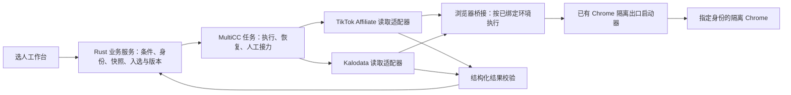

# 达人选人：回本率提示词、专属目录与任务接入方案

日期：2026-10-23。状态：设计方案与静态交互原型，尚未连接真实账号、执行采集或写入现有工作台。

本版按用户最新反馈修订：找达人采用现有回本率选人方法的可编辑提示词，不再让用户填写“这次想找什么样的达人”的多项筛选表格。初始化必须设置插件专属工作目录，之后从工作台发送的任务与对话都归属该目录。沿用工作台主体、MultiCC 执行与结构化回写原则；邮件、私信、正式联盟邀请均留到后续。

## 1. 本轮结论与边界

首次使用：**宿主主动安装，或手动复制后刷新识别 → 加载插件 → 选择插件专属工作目录 → 可选绑定已有隔离浏览器身份 → 进入工作台。** 日常使用：**套用回本率选人提示词 → 用户编辑并发送 → 自动在专属目录下创建 MultiCC 任务并投递首条指令 → 在原任务中补充和继续 → 结构化结果回到工作台。**

安装和刷新识别由 MultiCC 插件管理页提供。现有宿主已有目录扫描与插件面板刷新，尚无主动安装和初始化生命周期；已配置实例再次刷新应恢复原绑定，不重做初始化或清空任务。工作台就绪与浏览器启动、平台可读取分开显示。详见[插件安装、刷新识别与首次启动方案](plugin-installation-and-lifecycle.md)。

用户无须先把自然语言拆成类目、粉丝、成交额、时间窗等表单。必要信息由已有方法、活动资料和用户指令提供；仍缺少的信息由对应 MultiCC 任务一次性说明并补充。平台依赖未就绪不阻止用户创建任务，任务显示待连接；实际平台读取仍须通过相应检查。

初始化配置与日常选人分开。专属目录必填；隔离环境可以绑定，也可暂后配置。工作台只显示提示词示例、发送入口、任务进度和业务结果，不另建一套聊天系统。

三个必须拆开的概念：

- **达人是谁**：稳定的内部身份和各平台身份关联。
- **依据是什么**：来自某个数据源、某个统计区间和市场的指标快照。
- **为什么入选**：某个活动、某次选人任务中的判断与人工决定。

Chrome 环境也是独立对象。**默认复用已有的“Chrome 隔离出口启动器”（`chrome-proxy-launcher`）**，由它管理身份、隔离目录和出口；业务配置只引用身份／环境编号。TikTok Affiliate 与 Kalodata 可以绑定同一专用环境，也可以各用一个隔离环境。连接失败时不偷偷切换到其他账号或个人 Chrome。

本轮所说的“与平台沟通”是查询、读取、探测和错误处理，不包含发邮件、私信或邀请。静态原型里所有账号、候选与检查结果都是演示，不代表真实连通。

## 2. 工作台依赖的数据项

### 2.1 执行数据来自方法与对话，不是前置表格

下表是服务内部的数据契约，**不是需要用户逐格填写的界面**。创建任务时只要求有效的专属目录绑定和非空任务文本；平台读取、计算和保存结果时，再检查该阶段需要的字段。

| 数据组 | 最小字段与类型 | 必填规则 | 用途 |
| --- | --- | --- | --- |
| 活动 | 活动编号、名称、版本 | 可从当前工作台继承；暂无活动可先建任务，正式入选前补齐归属 | 避免跨活动混用名单与合作条件 |
| 商品与适配目标 | 商品引用列表、目标类目、内容方向、排除条件 | 读取现有资料；缺少计算必需项时在任务里补齐 | 沿用既有方法判断适配 |
| 市场 | 目标市场代码；可选目标受众市场、内容语言 | 目标市场必填 | 店铺市场、达人归属地、受众市场分别保存 |
| 统计区间 | 开始日期、结束日期、平台时区 | 使用区间指标时必填 | “近 30 天”必须解析成明确日期，不能只存文本 |
| 方法与执行条件 | 回本率方法引用及版本、实际公式和口径、输入快照、阈值、缺失项 | 计算前必须有已确认方法；不要自行替换为其他指标 | 让用户套用既有方法，并能追溯每次结果 |
| 金额口径 | 币种代码、金额单位 | 筛选或展示金额时必填 | 不能把人民币阈值直接用于美元值 |
| 来源策略 | 启用的数据源；必要能力；允许缺失的补充项 | 必填 | 决定一个来源不可用时能否继续 |
| 批次限制 | 目标候选数、读取上限、排序依据 | 设有限默认值，可调整 | 控制读取范围，避免把榜单截断结果当全量 |
| 历史排除 | 已入选本活动、重复达人、明确拒联等规则 | 本活动重复默认排除；历史状态来自工作台 | 查询平台不能覆盖本地已确认的合作事实 |

每个硬条件必须能匹配某个来源的明确能力。例如“最近 30 天成交额不少于 1 万美元”不能由无时间区间的累计成交额代替。来源不支持时提示修改条件或更换来源，不能悄悄忽略。

上例只是内部字段口径说明，不是新的默认选人规则。回本率结果另外保存：方法引用及版本、实际采用的公式、分子分母定义、必要输入与证据、成本／收益范围、币种、统计区间、估算标记、计算结果或不能计算的原因。是否纳入样品、运费、佣金、退款或履约概率，以已有方法为准，不能在模板里擅自设定；分母为零或未知时不能输出无穷值或伪造结果。实际表现与预测结果分别标注。

### 2.2 达人身份与来源关联

| 对象 | 字段 | 约束 |
| --- | --- | --- |
| 达人 | 内部达人编号、展示名称、规范化主页地址、当前账号名 | 内部编号不使用账号名；账号名可能变更 |
| 来源身份 | 来源类型、来源达人编号、来源主页、观测账号名、首次及最后观测时间 | 来源编号按“来源＋编号”唯一；必要时加市场命名空间 |
| 跨来源关联 | 两端身份、匹配依据、确认状态、确认时间 | 平台稳定身份或明确主页可作为强依据；同名和相似头像只能待核验 |
| 展示资料 | 头像、简介、内容语言、地区、类目 | 可为空；地区标注是账号、受众还是店铺地区 |
| 版本 | 对象版本、更新时间、更新来源 | 自动结果不能覆盖同时发生的人工修改 |

缺少稳定来源编号但有可靠主页时可进入“待核验候选”。来源返回的不同编号不强行合并；昵称、相似姓名、不同站点的同一串数字都不能作为唯一合并依据。只有完成身份核对的候选才自动关联已有达人。

所有外部编号按字符串保存，避免大整数精度丢失。主键、来源身份和活动成员关系应分别约束：内部达人编号永久稳定；来源身份按命名空间唯一；已确认达人在同一活动只保留一个成员关系；批次候选与来源观测可以有多条。未确认身份不能绕过冲突检查自动变成第二份已确认达人。

### 2.3 指标快照：数值和口径一起保存

| 指标组 | 例子 | 选人要求 |
| --- | --- | --- |
| 基础规模 | 粉丝数、粉丝增长、受众分布 | 根据实际能力提供；缺失不为零 |
| 带货表现 | 成交额、成交件数、客单价、真实带货商品数 | 保留来源的估算属性、区间、币种与市场 |
| 内容表现 | 视频数量、播放、互动、直播占比 | 明确是全量、近期样本还是榜单样本 |
| 类目适配 | 类目编号与名称、相关商品、同类目销售占比 | 不同平台类目分别映射，不共用裸编号 |
| 可合作性 | 联盟资格、平台可见的可联系状态 | 若无法读取则未知；不据此推导已授权发送 |

每条指标至少包含：指标名称、可空的数值、原始显示值、单位、统计区间、时区、币种（金额时）、目标市场、来源身份、抓取时间、来源链接或证据引用、质量状态。金额建议使用十进制定点字符串，避免浮点累加误差；计数使用非负整数。

质量状态应区分：有值、缺失、无权限、源不支持、已过期、解析失败。真实的零只有在平台确实返回零并且解析成功时成立。区间范围、模糊值和平台估算不能转换成虚构的精确数字。

同一达人来自两个平台的成交额保存为两份观测。默认并排展示或按用户选择的来源排序；未经同口径核对，不求和、不平均、不用一份覆盖另一份。做币种换算时同时保存原币金额、汇率、汇率日期和换算币种。

数据截至时间与抓取时间分别保存；不能用重新读取缓存的时间把旧指标显示成最新。金额还要区分全类目、目标类目、视频、直播、店铺合作累计等业务范围，不能混加。

### 2.4 现有字段怎样衔接

这些是源码中的既有字段，不代表本轮已从平台取得：

| 现有字段 | 新契约落点 | 兼容注意 |
| --- | --- | --- |
| `id`、`handle`、`tiktok_url` | 内部达人身份与展示资料 | 保留旧编号；新编号不能按排名生成 |
| `oec_id`、`affiliate_url` | Affiliate 来源身份 | 与 Kalodata 编号分开保存 |
| `kalodata_id`、`kalodata_url` | Kalodata 来源身份 | 同账号名只能提供待核验匹配线索 |
| `followers` | 粉丝数观测 | 时点值，带来源和观察时间 |
| `affiliate_gmv_usd`、`affiliate_video_gmv_usd` | 来源金额观测 | 原源码展示为全类目；不当作目标类目成交额 |
| `ec_videos_30d`、`all_videos_30d`、`ec_lives_30d` | 内容活跃指标 | 保存平台定义与实际统计截止时间 |
| `diligence`、`sample_score`、`sales_ability_score` | 平台评分观测 | 保留尺度与来源，不改称自建预测概率 |
| `pet_gmv_share_pct`、`video_gmv_share_pct` | 来源比例指标 | 标注分母、范围与百分比单位 |
| `products[]`、`observed_product_sales` | 商品证据和估算销量 | 商品成交估算不等于视频已观看或订单已确认 |
| `kalodata_window`、`score_window_raw`、`sales_end_utc` | 各来源／指标的统计区间 | 不能把单一窗口套在所有指标上 |
| `data_collected`、`source_ref` | 抓取时间与证据引用 | 不能替代数据截至时间 |
| `priority`、`angle`、`topic`、`warnings` | 活动候选判断与人工编辑 | 保留人工内容，刷新资料不覆盖 |
| `prior_invite`、`stage` | 既有合作／触达摘要引用 | 选人状态另存；旧快照未匹配不等于从未触达 |

现有导入脚本按固定 100 人生成档案；旧列表直接依赖完整档案字段，并有空值转换为零的显示问题。新候选须走独立校验入口，不能直接塞进旧初始化脚本。旧合作设置中的佣金、联系人、渠道准备条件也不能拿来阻塞选人。

旧库还对 `creators.handle` 设有唯一约束。首期保留旧达人编号，将待核验来源身份与冲突候选独立保存；正式接入旧档案前需要受控的结构升级或兼容映射，覆盖改名和账号名重用，不再以旧账号名唯一性判断是否同一人。本轮不修改该约束或迁移真实数据。

### 2.5 证据、候选和选择结果

| 对象 | 最小字段 | 行为 |
| --- | --- | --- |
| 内容／商品证据 | 平台对象编号或链接、标题、类型、采集时间、所属达人、必要的样本指标 | 用于解释适配；截断样本不作为真实总量 |
| 选人批次 | 批次编号、活动版本、条件快照、使用的连接及版本、任务关联、状态 | 页面刷新后能恢复；条件变化生成新修订 |
| 候选项 | 批次编号、候选编号、身份引用、指标快照引用、逐条条件结果 | 硬条件结果使用通过／不通过／未知；未知不算通过 |
| 适配意见 | 入选理由、风险、待核实项、引用证据、规则或模型版本 | 自动建议与平台事实分开；解释得分来源 |
| 选择决定 | 待评估／入选／排除／稍后、决定理由、操作者、时间、版本 | 选择是活动内关系，不全局修改达人合作阶段 |
| 读取进度 | 来源游标、页数、已读数、覆盖上限、是否结束、终止原因 | 区分读完、限额停止、部分失败和真实零结果 |
| 执行关联 | 操作编号、MultiCC 任务与会话编号、幂等编号、结果版本 | 宿主任务结束不等于业务已保存 |

邮箱、手机号、收件线程、草稿、发件账号、报价、寄样地址不作为这一步的前置必填项。后续从已入选达人延伸，不为选人提前申请全部沟通权限。

来源快照还应有独立编号、契约与适配器版本、采集结果，以及**实际执行**的账号／店铺／市场／环境配置指纹，用于核对是否与操作单一致。缓存键至少包含来源、账号／店铺、市场、统计区间、币种、请求条件、环境配置版本和适配器版本；命中缓存时保留原抓取时间及是否过期，不能假称本次实时读取。

## 3. 抽出两类平台适配器

### 3.1 谁负责什么



工作台不直接调用网站内部接口，也不保存 Cookie。适配器不决定最终入选、报价或合作阶段。MultiCC 继续负责任务与人机协作，不在插件里另建调度系统。

### 3.2 统一的读取契约

以下是建议新增的契约名称，不是已经存在的宿主 API。

| 动作 | 输入 | 输出与边界 |
| --- | --- | --- |
| 检查能力 | 连接编号、配置版本、必要能力、探针范围 | 账号／店铺／市场核对结果，可用能力，检查时间、失效时间和具体失败原因 |
| 查找候选 | 操作编号、条件快照、连接编号、可选游标、单页上限 | 候选观测、分页游标、覆盖声明、警告、逐项错误 |
| 读取达人 | 来源身份、需要的字段集合 | 身份与指标快照；不自动扩展到联系方式解锁 |
| 读取依据 | 来源身份、商品／内容类型、样本上限 | 可追溯样本与覆盖范围 |
| 提交结果 | 操作编号、结果编号、基准版本、来源观测及候选项 | 校验后的业务记录编号与新版本；重复提交返回原结果 |

每次执行显式携带连接编号、环境编号、配置版本、预期账号、市场、日期区间和币种。适配器不能使用隐式的默认浏览器、默认页签或脚本内写死的日期。

读取响应应同时报告传输状态与业务状态。HTTP 成功、脚本退出成功、安装了技能，都不能代替“账号正确且该能力可用”。有效的空结果必须满足：登录与权限正常、响应结构正确、查询确实执行、分页和覆盖情况明确。

错误至少区分：环境缺失、环境忙、连接失败、需要登录、账号或店铺不符、市场不符、需要人工验证、能力无权限、额度不足、触发限流、页面结构变化、字段解析失败、部分结果、取消和超时。限流按平台提示等待并有限重试；登录、验证、权限与结构变化不做批量盲重试。

### 3.3 两个平台分别提供什么

| 来源 | 优先承担 | 限制与产品处理 |
| --- | --- | --- |
| TikTok Affiliate | 店铺市场内候选发现、平台侧筛选、可见的达人详情及联盟相关资格 | 依赖正确店铺、市场与账号权限；当前接口和字段需实测，不能宣称有通用官方接口 |
| Kalodata | 类目发现、第三方带货指标、商品与内容依据补充 | 依赖会员与区间权限；估算指标保留来源；榜单覆盖、截断数组不能冒充全量 |
| 本地已有资料或人工导入 | 继续评估已有候选 | 展示来源和更新时间；不能冒充平台实时读取 |

已有读取脚本的具体映射线索：Affiliate 的 `creator_oecuid.value`／`base.oec_id` 是来源身份；`follower_cnt.value` 是粉丝；`video_gmv`／`live_gmv` 是不同范围金额；`sample_credit_diligence_score` 是平台履约信号。Kalodata 的 `id`、`followers`、`revenue`／`total_revenue`、`product_count` 分别映射来源身份、粉丝、来源成交额和真实带货商品数。字段是否在当前账号可见、时间区间与单位是否完整，仍须样本核验。

Kalodata 的 `video_ids`、`product_ids` 在历史接口中有截断，数组长度不能当总量；`related_creator_count` 是关联达人数，不是视频数。历史类目榜单固定前 10 条，应标“榜单样本”。店铺 CRM 的累计合作成交额不能用来满足达人近 30 天全类目成交额条件。

不固定要求“两平台都成功”。若当前选人条件只依赖 Affiliate 已通过检查的能力，Kalodata 不可用时允许继续并显示缺少的补充信息；反之亦然。用户把某项指标设为硬条件，而所有可用来源都不能提供时，阻止执行当前条件，并给出具体可调整项。两平台都不可用时，在线选人不可执行，已有名单评估仍可独立使用。

这里的阻止仅针对需要该能力的读取／计算动作，不阻止工作台把请求投递到 MultiCC。任务可以先核对方法与资料，再以待连接或待补充状态继续同一段对话。

一条完整执行路径可以组合两个来源提供的能力，不要求每个平台都提供全部字段。能力检查通过后，某位候选仍可能缺值：可以预览、保留和补采，但硬条件未知或不通过者不能显示“满足条件”或自动入选。若后续允许人工例外入选，必须单独记录例外决定与理由，保留原条件结果；首期不默认提供绕过硬条件的快捷按钮。用户明确要求双源核验时，单源结果仅为待补候选。

## 4. 专用 Chrome 与环境配置

### 4.1 默认复用 Chrome 隔离出口启动器

优先选择该插件中既有、身份匹配的隔离环境。没有合适环境时，从引导进入插件原有管理界面创建，再返回刷新。选人工作台不再实现代理订阅、节点、账号密码、指纹扩展或浏览器目录管理。

| 已有插件能力 | 选人如何复用 | 仍需补齐 |
| --- | --- | --- |
| 身份清单 `list` | 展示可选择的身份、名称、运行状态和脱敏出口摘要 | 原始清单包含代理与订阅配置；需专用脱敏摘要，不能原样交给任务或选人页面 |
| 创建／修改 `save` | 引导进入既有插件配置 | 保存后刷新引用，并让旧检查失效；不复制配置表 |
| 启停 `launch`／`stop` | 由插件持有浏览器与出口生命周期 | 启动需通过后台操作兼容性验收；不能因任务完成而停止共享环境 |
| 测出口 `probe` | 展示出口检测结果及时间 | 可能启动临时内核／中继；只证明该代理链路探测成功，不证明 Chrome 内平台页面可读 |
| 准备出口 `egress` | 未来需要独立执行器时可按身份取得受控出口 | 会启动或复用代理内核／中继，不是纯只读查询，也不是浏览器控制地址 |
| 私有管道与监督进程 | 优先在原监督进程上扩展受控自动化桥接 | 当前未提供通用自动化命令或可供 mbrowser 连接的地址 |

**当前最重要的技术缺口是自动化桥接。** 该插件默认自动指纹模式使用私有 `--remote-debugging-pipe`，没有 TCP 调试端口；不能把 `launch` 成功当作已经接通 mbrowser。普通启动分支也不能假定提供可连接的调试地址。

建议由插件的 Rust 监督进程继续独占管道，增加本机受控进程协议，按已绑定身份分配任务标签页，承接有限的导航、读取、截图与必要页面调用。需有调用者校验、命令范围、任务归属、超时、取消和并发协调；不向页面暴露任意 CDP 或任意命令执行。控制链路还须验证不会激活窗口或影响其他任务。mbrowser 如需复用这条链路，接入新协议，而不是假装已有 TCP 可直接连接。

这是需要在宿主插件独立任务工作区实现的新增适配，本轮不修改宿主。备选的“只借用出口，再启动另一个自动化浏览器”会产生另一份登录环境，必须明确区分，不能宣称复用了原身份登录态；不作为默认路径。

现有可复用路由已在源码中确认：`GET /api/plugins` 获取插件清单和可执行状态；`POST /api/plugins/chrome-proxy-launcher/run` 接收命令与输入；管理页为 `/plugins/chrome-proxy-launcher/ui/index.html`。这些是宿主同源鉴权入口，不能在公开服务页直接获得管理权限。命令调用有约 20 秒超时，适合短操作与受理回执；持续选人任务必须异步关联 MultiCC 任务。新建的脱敏目录与自动化桥接接口尚不存在。

| 配置对象 | 保存的信息 | 不保存的信息 |
| --- | --- | --- |
| 浏览器环境 | 环境编号、用户名称、驱动类型、出口插件身份编号、状态与版本、自动化桥接版本 | 不复制代理凭据、订阅地址或完整浏览器目录 |
| 数据源连接 | 来源、环境编号、预期账号标识、预期店铺、市场、能力与配置版本 | Cookie、密码、令牌、登录页内容 |
| 检查记录 | 连接及环境版本、账号核对、逐能力结果、检查和失效时间、有限证据引用 | 全部标签页信息、请求头、无关账号资料 |
| 执行使用记录 | 操作编号、环境、会话、当前任务标签页、占用或租约期限 | 无归属的浏览器全局控制权 |

专用环境的登录态由宿主持久目录保存，跨任务复用。任务工作区只放代码；工作区回收不能删除浏览器登录态和业务配置。

产品内提供两种主路径：“使用出口插件已有环境”“到出口插件新建环境”。高级接入可选择宿主已登记的外部专用 Chrome，但需先证明连接归属、可达性和隔离目录；选人模块不接受任意网址并直接连接。浏览器控制链路仅本机受控访问，产品页面不展示可复用的控制地址。个人 Chrome 不列入默认候选。

不同身份隔离登录数据，不意味着一定使用不同公网 IP；若绑定同一节点，可能共用出口。插件的固定代理和探测也不是系统级防火墙保证。选人页展示实际出口状态与检测时间，不承诺尚未验证的网络隔离强度。插件移除了本地代理绕过，其浏览器不一定能访问本机工作台页面；自动化控制与结果回写应走宿主进程桥接，不能依赖在该浏览器里打开 localhost 管理页。

### 4.2 绑定与生命周期

- 默认可让两个不同站点共用一个选人专用环境；如果已有独立账号环境，允许分开绑定。同站点不同账号或不同团队身份使用不同环境。
- 一个持久浏览器目录只由一个浏览器进程持有。运行中的环境原地复用，不强制重启、不删锁、不抢占其他任务标签页。
- mbrowser 已有会话标签页隔离，但出口插件不会自动继承这套机制。新增桥接须落实标签归属，并补充按连接／账号的读任务协调，避免同一账号的并发任务反复切店铺、切市场或登录。若共享同一环境影响登录态，则按环境串行排队。
- 每次执行前重新核对指定环境和当前站点账号。检测过期、账号变化、店铺切换、配置修改均触发重新检查。出口插件尚未提供的配置版本可由脱敏摘要生成指纹并在执行前比对；不读取秘密到任务上下文。
- 新建、连接已有环境、启动未运行环境是不同动作，界面要解释实际会发生什么。接入外部环境只连接，不替用户关闭或重启。
- 正常操作保持后台，不置前或抢焦点。人工登录／验证需要窗口时，让用户自行进入；如果必须重启才能进入人工登录，先检查其他任务并协调，不自动重启在用环境。
- 结束时释放本次任务占用，关闭仅属于本次的临时标签；不删除环境、不清理登录态。取消任务和宿主崩溃后要能对账并释放过期占用。

### 4.3 旧脚本的改造方向

历史脚本的固定端口、固定标签编号、固定日期、固定类目和本地输入文件都应移出连接器核心。用宿主环境引用选择目标，再注入任务条件。页面脚本仅作必要的浏览器协议和站点读取桥接；解析、单位标准化、身份匹配、能力判断、筛选、缓存与业务写入放在 Rust。

允许保留的 Node 范围是已有宿主浏览器能力和必要的 CDP／页面调用适配，因为它们属于现有 Node 专属宿主接口。不得把新的选人规则或业务数据库操作放进这层。宿主提供稳定进程协议或 Rust 可用接口后，再替换不再必要的桥接；现有 Python 脚本仅作行为参考，不原样上线。

## 5. 依赖检测：检测到具体能力

| 层级 | 检查项 | 通过证据 | 失败后的界面动作 |
| --- | --- | --- | --- |
| 本机与执行器 | 浏览器执行器可调用、兼容的 Chrome 内核存在 | 执行器报告和版本校验 | 显示明确缺项，引导安装／配置；不自动下载安装 |
| 环境与出口 | 出口插件可用；绑定身份存在、归属正确；目录无错误占用；指定出口有效 | 脱敏身份摘要、运行状态和带时间的出口探测 | 进入既有插件修复，或等待占用；不在选人页重配订阅 |
| 自动化桥接 | 指定身份可通过受控桥接操作本次任务标签 | 真实握手和任务标签页读取 | 显示“自动化接入待完成”；浏览器正在运行不能代替此项 |
| 站点网络 | 目标站点在该 Chrome 环境中可达 | 浏览器内目标页面或最小请求响应 | 修复该环境网络；不自动换出口 |
| 身份 | 已登录；账号、店铺、市场符合预期 | 当前页面或账号接口的限定字段 | 去登录、重新绑定或切到明确指定的店铺 |
| 权限 | 当前账号能使用本次必要的查询和指标区间 | 低成本只读探针及明确业务状态 | 标记会员不足、额度不足、无此能力或需要人工处理 |
| 响应结构 | 字段、单位、日期与身份可解析 | 最小样本结构校验 | 标记连接器需更新，不把结构变化解释为零人 |
| 工作台保存 | 业务服务可用、契约版本兼容、操作能关联任务 | 健康／契约检查；真实回写须入库后读回 | 保留待回写状态，不显示已入选成功 |

优先检查便宜的依赖，再做站点探针。检查不是全量采集：最多读取必要的小样本，不触发联系信息解锁、邀请、消息发送或付费导出。可能耗用明确计费额度的探针需单独标识，默认不在普通连接检查中执行。

检查结果显示“就绪、部分可用、需要登录、需要人工处理、权限不足、环境占用、不可达、未检查／已过期”，并逐项说明受影响的能力。不要只给一个绿色“已连接”。

现有出口类型字段中的 `direct` 表示直接连接已配置的代理，不应翻译成“无代理”。某些代理协议的出口探测尚不支持，应显示“不支持此探测”，而不是报成平台未登录或断言网络不通。

绑定任一环境、账号、店铺、市场或必要筛选条件改变后，对应检查立即失效。短期缓存只是界面提示；真实执行前仍再次核对身份、必要能力和配置版本。执行途中登录态失效则保存进度并暂停，恢复后沿用原批次，不重复导入已写回候选。

人工步骤复用 MultiCC 的任务和截图协助。验证码、扫码和无法识别的界面应明确停在哪一步；密码与令牌不进入工作台或聊天，凭据使用宿主已有安全入口。

## 6. 初始化专属目录，日常通过提示词发任务

### 6.1 初始化只做一次的设置

首次打开插件先引导用户选择或新建一个**持久的专属工作目录**。页面说明：“后续从达人工作台创建的任务和对话，都归到这里；方法资料和任务结果也在这里管理。”不能默认把当前开发工作区当作用户运营目录。

| 初始化项 | 用户操作 | 正式实现的核验 |
| --- | --- | --- |
| 专属工作目录，必填 | 使用宿主目录选择器选择已有目录，或明确创建新目录 | 解析真实绝对路径、存在／创建结果、目录类型、访问权限与可写性；校验符号链接目标；禁止回收型任务工作区和临时目录 |
| 目录用途说明 | 阅读将用于本插件任务与资料的说明 | 不自动搬迁旧任务、真实名单或现有服务数据 |
| 隔离环境，可后补 | 绑定出口插件已有身份，或稍后到设置页完成 | 只保存身份引用；未连接时新任务显示待连接 |
| 完成初始化 | 保存目录与插件绑定 | 保存宿主目录编号、规范路径、配置版本并读回；失败时保留输入，不假称已设置 |

初始化选择目录与“检测目录”不同。目录登记接口可能创建文件夹、初始化 Git 和项目会话；产品应在提交前说明实际动作，不把有副作用的登记当成只读校验。已有非空目录需明确选择并验证归属，不覆盖内容。自动产生提交的路径还须遵守英文说明与提交身份策略，未兼容前不能把直接调用视作完整可用方案。本轮不登记真实目录、不创建初始提交。

工作台保存 `workspaceBindingId`、宿主 `dirId`、规范路径、绑定版本、显示名称和初始化状态。客户端路径文本不是可信执行参数，后端通过绑定编号解析并校验范围；不能让页面传任意目录执行任务。配置持久化在宿主或插件的持久存储中，不放任务工作区。

目录与其他位置的关系：

- **插件代码目录**：承载插件程序；本仓库的开发工作区只在这里修改代码。
- **插件专属工作目录**：用户选定的运营项目，作为后续任务与对话的归属，保存批准的方法和业务资料。
- **任务执行工作区**：MultiCC 可能按任务创建的独立工作区；不是持久资料的唯一保存位置。
- **浏览器登录目录**：继续归出口插件管理；不复制到专属工作目录。

“承载对话”指所有任务和会话关联同一个专属项目目录；对话原文、执行状态与模型上下文仍由 MultiCC 保存。无需在插件里复制聊天历史，也不意味着不同任务自动获得所有其他对话的内容。通用方法经用户确认后保存为可引用资料；跨任务上下文按宿主授权机制读取。

修改专属目录只影响后续新任务；旧任务绑定原目录、原配置版本和原始输入。旧任务继续对话时不能被重新投递到新目录。默认不迁移历史任务，也不随卸载删除目录。目录失效时阻止新建任务并提示修复，已有任务仍显示它的真实关联状态。

实现时选择或登记新的宿主目录编号，再保存新的插件默认绑定；不能通过修改旧宿主目录记录的路径来切换插件目录，因为旧任务仍引用那条共享记录。宿主已有目录按真实路径去重，重复登记并不自动返回成功，初始化应先查询并复用匹配编号。

### 6.2 日常页面只留提示词与发送入口

“找达人”页面以“按回本率找达人”为主卡，显示可套用的提示词、一个可自由编辑的文本框，以及“发送到 MultiCC”按钮。任务标题可从文本生成；不要求用户再逐项填市场、类目、粉丝和成交额表格。

建议预填示例：

> 请按我们现有的扣广回本率方法，为当前商品筛选达人。先读取本工作台专属目录中的商品、成本与合作条件，未确认参数标为缺项或情景假设。读取同一统计窗内新发的带货视频，保留零成交样本；按每条视频的成交额、佣金前贡献率、佣金、广告消耗、固定合作费和寄样分摊计算结余。扣广回本率用“结余严格大于零的视频数／同期新视频总数”，展示分子、分母及至少两位小数，同时给出平均结余、自然流表现、报价与数据覆盖率。自然和广告佣金不同时分开计算，不重复计入成交额。按本次任务给定的门槛筛选，使用未四舍五入的值判断，不能把低但非零的结果排成零。注明来源、时间窗、币种和换算依据；缺失数据不当零，不用粉丝数、总成交额或广告 ROI 代替合作回本率。历史样本表现不能保证新品合作收益。结果结构化写回工作台；缺少信息在原任务中补齐，不发送消息、邮件或合作邀请，也不自动接受报价。

这是**任务提示词示例**，不是一份新回本率算法。用户可以直接发送，也可以追加商品、人数、市场或其他要求。已有输入被编辑后，重新套用模板应支持取消覆盖或恢复编辑稿，不能静默丢掉用户文本。

已按用户指定的正常只读 API 核查原达人沟通任务，确认应套用的是同期新视频的**扣广保本命中率**。旧选人脚本的勤奋度、类目份额等可作辅助证据，不能替代这个指标。方法资料应随插件初始化登记到专属目录，记录版本与来源；任务引用该版本，而不是要求用户自己重建公式。商品成本或具体合作参数缺失时，在原任务补齐，不增加参数表。

方法定义如下：

```text
单条视频结余
  = 视频成交额 ×（佣金前贡献率 − 佣金率）
    − 该视频广告消耗 − 每条固定合作费 − 每条寄样分摊费

扣广回本率
  = 结余严格大于 0 的同期新视频数量 ÷ 同期新视频总数量
```

若自然成交与广告成交采用不同佣金率，分别计算贡献后再相加；两部分必须互斥且不超过总成交，不对总成交重复扣佣金。纯自然流表现、未扣广告的原口径和扣广口径分开保存，名称不能混用。扣广回本率是一组历史视频在给定合作条件下的模拟命中占比，不是利润率、广告 ROAS 或实际合作回报率。

沿用方法时的具体规则：

- 新视频与收入、广告费使用同一窗口，显式限制起止日期并规范日期格式。旧程序只加下限、依赖快照截止日期的做法不应成为新默认。
- 保留零成交和负结余样本，零结余不算命中。缺金额或广告费不补成零；报告总样本、可计算样本和未知项，覆盖不足时不把已知子集占比冒充完整保本率。
- 贡献率、佣金、固定费、寄样分摊、汇率均保存来源与确认状态。历史会话中的贡献率与寄样数值是测算假设，不硬编码为所有用户的真实成本；历史汇率也不作未来默认值。
- 同时展示命中次数、分母和平均结余，按未舍入的比值筛选。很小但非零的比例不能在筛选时当零；平均结余为负与少数视频命中可以同时成立。
- 原会话中的“扣广回本率不为零”是某次联系批次的条件，不升级为永久排除规则。合作费或佣金改变后产生新的计算版本，旧零值不能代表新报价结果。
- 不把历史广告花费写成我方已支出或未来预算；平台估算、历史数据与实际经营结果分别标注。正式结果保留来源证据和模型假设。

本仓库和公开演示仅保存方法，不复制源会话名单、报价表或生产数据。具体历史数值在当前用户会话中核对；不得拿示例或历史估算冒充本轮真实采集结果。

### 6.3 从工作台自动投递到 MultiCC

发送应由插件连接层完成；用户无需复制提示词到另一个窗口。界面显示“创建任务 → 投递指令 → 已受理／待补充／待连接”，并提供宿主返回的原任务入口。工作台仍展示候选和结果，不复制一个独立聊天系统。

每次发送先持久化操作单：操作编号、专属目录绑定及版本、最终提示词快照、模板版本、方法引用与版本（可为空待补充）、活动引用（若有）、来源连接引用和用户范围。之后按两阶段处理：

1. 创建任务并保存返回的任务／会话／工作壳编号及入口。
2. 向这个任务自动投递首条指令，保存受理回执。创建任务成功不是指令已投递，受理也不是业务已完成。

提示词的自然语言之外，目录绑定、操作编号、结果回写契约和仅选人的范围由系统附加，用户不必手工填写。平台连接引用不得包含 Cookie 或代理秘密。发送后的编辑只影响下一次提交；已创建任务保留当时的输入快照。

以下接口已通过只读源码核查，新增插件连接层仍待实现：

| 环节 | 现有接口 | 实际契约 |
| --- | --- | --- |
| 选择目录 | `GET /api/fs/list?path=...` | 返回可选目录；不等于完成可写检查 |
| 查已登记目录 | `GET /api/directories` | 返回目录列表，匹配规范路径后复用 `id` |
| 初始化目录 | `POST /api/directories` | `{name,path,create}`；返回目录对象；可能创建目录、初始化 Git 与协调会话，不作普通检测调用 |
| 创建任务 | `POST /api/air/tasks` | `{dirId,title,clientMsgId,...运行时选择}`；返回 `taskId/sessionId/shellId/url`；不接收 `dirPath`，不自动执行提示词 |
| 投递指令／继续对话 | `POST /api/task-shell-tasks/:taskId/messages` | `{clientMsgId,text,intent:"work",lang:"zh"}`；返回 `receiptId/decision` 等；排队不等于执行完成 |
| 核对回执 | `GET /api/task-shells/:shellId` | 查看对应消息编号的受理／投递状态 |
| 重试已知失败回执 | `POST /api/task-shells/:shellId/receipts/:receiptId/retry` | 沿用原消息与任务身份 |

创建与首条消息各用一个稳定的 `clientMsgId`，重试不换编号、不换内容；不同内容复用同编号会发生幂等冲突。任务标题最多 120 字符，消息最多 32000 字符，界面与后端都校验。创建时显式沿用用户选定的运行时配置，不能因省略 `cli` 而误用宿主默认运行时。

任务创建时执行工作区可能仍是待准备状态，不能把创建成功显示成目录和执行器已全部就绪。上述请求通过宿主授权桥接完成，不在公开预览页直接调用；结果回写与任务创建／投递分别记录。

| 情况 | 正确处理 |
| --- | --- |
| 双击发送或网络重试 | 同一操作和稳定请求编号只创建一次任务、投递一次消息；界面临时禁用仅为辅助，服务端幂等是依据 |
| 创建成功，首条指令投递失败 | 显示“任务已创建、指令未投递”；重试沿用原任务和原消息编号，不新建任务 |
| 创建／投递请求超时，结果不明 | 按稳定请求编号对账，或用原编号安全重试；不能换编号盲发 |
| 用户编辑文本后再次发送 | 建立新的操作及输入快照；保留之前任务。可清楚选择在原任务补充而不是重新发起 |
| 缺登录、连接或方法资料 | 可以创建并投递任务；任务按具体原因待连接／待补充，停止需要该依赖的实际读取或计算 |
| 在任务里继续讨论 | 用原任务编号投递新消息，产生新的消息编号；不创建新任务，不改它的目录绑定 |
| 关闭页面或重开工作台 | 从已保存的操作／宿主状态恢复；不因刷新再次派发。原型内存模式不代表已实现持久化 |
| MultiCC 已完成，但结果未回写 | 显示待回写或回写失败；只有业务校验、保存并读回后才显示完成 |

### 6.4 原型范围

对应文件：[可点击安装、初始化与发任务原型](../prototype/selection-setup.html)。原型新增宿主插件管理模拟入口，演示主动安装、手动复制后刷新识别、校验与加载失败重试，再衔接专属目录设置、已有隔离身份绑定、提示词编辑、两阶段投递、原任务继续对话和历史目录关联。所有安装、扫描、加载、目录检查与任务状态都是模拟；没有真实安装、目录登记、文件创建、任务投递或平台调用。

正式实现保留现有达人列表和档案，在其上增加任务入口与回写，不能维护第二套达人事实库。目录校验、绑定、操作幂等与读模型由 Rust 实现；宿主 Node 接口仅作必要桥接。

## 7. 实施顺序与验收

| 切片 | 交付物 | 可核对的验收证据 |
| --- | --- | --- |
| 0. 插件安装与发现 | 宿主安装入口、完整插件包、刷新识别与初始化状态契约 | 主动安装与手动复制汇入同一流程；坏包错误可见；重复刷新不重置绑定；真实重启恢复另验收 |
| 1. 专属目录初始化 | Rust 目录绑定、宿主目录选择／登记桥接与持久配置 | 必填且真实可用；重开保留；不采用临时工作区；不迁移旧任务 |
| 2. 提示词到任务 | 回本率方法引用、可编辑示例、两阶段投递与任务关联 | 不填筛选表即可发任务；双击不重复；投递失败复用任务；改目录不改旧任务 |
| 3. 环境与单源读取 | 复用出口插件、脱敏目录、受控自动化桥接与读取检查 | 待连接任务可恢复；方法缺失不编造；来源快照、回本率依据和结果可读回 |
| 4. 双源与数据完整性 | 身份核对、同口径计算、字段缺失、证据与版本 | 不以同名并人；回本率不能计算时说明原因；不同来源不覆盖；重复回写幂等 |
| 5. 工作台结果闭环 | 候选结果、活动入选、原任务继续与刷新恢复 | 对话回到原目录／任务；受理与完成分开；不产生消息或邀请 |

真实账号接入前，以合成样本覆盖：正常、零结果、登录失效、权限不足、限流、结构变化、错误币种、不同区间、重复页、过期检测、账号切换、环境忙和中断恢复。账户验收再用用户选定的环境和有限样本证明实际能力。模拟成功不能替代账号验收。

后续邮件和私信从“活动内已入选达人”进入，各自增加渠道账号、授权与回执，不反向扩大这一步的依赖。

## 8. 本轮证据与未验证项

本轮核查需求、代码／技能说明，以及用户明确指定的原达人沟通任务。通过正常只读历史 API 读取该任务的 378 条消息，核对相关成功计算结果与后续更正；未修改源任务或发送消息，未直接读取生产数据库、Cookie 或密钥。源码存在代表可借鉴实现，不代表当前平台接口仍有效。

方法来源：[原达人沟通任务](/air?task=tsk_fbbb7bc99c388abec8690a3a67a684ea&dir=b5d3e3ce-4ff7-4bbc-99c5-11c300f54432)。关键证据为 `mmvgkfdmb-1m` 的逐视频扣广计算、`mmvib1ggd-6h` 的日期与币种修正后成功复算；用户消息 `mmvicbw6f-7m` 说明当批非零推进条件，`mmvkey410-rj` 说明后续个案报价发生变化。文字结论与成功计算明细冲突时，以可核对的计数和计算为依据，不沿用舍入错误。

### 已核查的源码证据

下表路径均为只读参考，行号对应本轮核查时的源码。

| 证据 | 路径与定位 | 支持的结论 |
| --- | --- | --- |
| 旧工作台导入 | `gapasea-marketing/tools/creator_outreach/build_seed.py:18,41` | 固定名单生成身份并把多个来源压入档案 |
| 旧业务存储 | 同目录 `store.py:31,39,60,71` | 未有活动候选／来源快照表；已有档案不经初始化更新；合作准备条件与选人应分开 |
| 旧列表和详情 | 同目录 `app.js:5,11,14` | 仅本地筛已有名单；空值显示与扁平指标需兼容处理 |
| 联盟与数据平台读取 | `gapasea-marketing/ttshop_out/creator_efficiency/screen_creators.py:32,77,158,222` | 已有搜索、分页、详情、商品证据代码；端口、目标页与参数依赖需要移出 |
| 联盟市场与店铺记录 | 同目录 `pull_market_creators.py:27,80`、`pull_affiliate_creators.py:44,106` | 两类读取口径不同；已有部分端口参数化线索 |
| Kalodata 采集 | `/Users/Zhuanz/.claude/skills/kalodata-tiktok-analytics/scripts/pull_opportunities.py:67,171,499` | 固定端口、缺失归零和金额单位错位不能原样复用 |
| Kalodata 字段限制 | 同技能 `reference/api_reference.md:58,61,74,110` | 数组截断、榜单前十、关联达人数与真实商品数的区别 |
| 出口插件接口 | `multicc/plugins/chrome-proxy-launcher/plugin.json`、`src/main.rs:143,219,304,392,458` | 插件版本、身份、启停、出口探测与准备能力 |
| 出口插件字段 | 同插件 `src/store.rs:23,54,77,92` | 原始清单有敏感字段，需要白名单脱敏投影 |
| 浏览器管道 | 同插件 `src/browser_session.rs:190`、`src/chrome.rs:239,336` | 私有管道和普通分支都没有现成的 mbrowser 接入端点 |
| 外部浏览器连接 | `multicc/skills/multicc-browser/lib/lifecycle.js:246,276`、`lib/daemon.js:156` | mbrowser 可连接本机调试端点，但映射须独立且不能覆盖既有归属 |
| 插件宿主通道 | `multicc/src/routes/plugins.js:27,78,120,205,209,215` | 命令时限、插件清单、执行路由与管理页 |
| 专属目录登记 | `multicc/src/directory/controller.js:34`、`service.js:116`、`src/directories.js:118`、`server.js:672` | 目录选择、登记、可写探针与 Git 初始化副作用 |
| 创建任务 | `multicc/src/task-shell/task-actions.js:187`、`src/workspace/air-routes.js:603` | 以 `dirId` 创建任务、幂等编号、返回标识及延迟准备的工作区 |
| 消息与回执 | `multicc/src/task-shell/routes.js:58,72,167`、`runtime.js:445,482,576,655,808` | 原任务投递、回执状态、去重与重试 |

上表 `gapasea-marketing/` 位于 `/Users/Zhuanz/Downloads/gapasea-all-in-one/code/`；`multicc/` 位于该目录下的 `claudecode/`。技能在 `.codex` 的入口可见，但本轮发现对应脚本和参考文件实际位于 `.claude`，因此安装完整性也要单独检查。

### 交付状态

已核实原方法和源会话中的计算差异，形成安装／刷新识别、专属目录初始化、回本率提示词、两阶段投递与原任务续聊方案。数据契约、来源口径和出口插件复用设计继续适用。真实安装机制、目录登记、任务投递、平台连接、自动化桥接与回写仍待实现；没有以静态原型代替这些验收。

新增安装流程前的原型已通过 9 项核心验收：目录格式门禁；已核实的提示词口径且无筛选表／伪造候选；双击去重与输入快照；投递失败重试原任务；创建失败复用操作编号；切换目录不改历史且继续原任务；恢复模板需确认；桌面与手机无页面横向溢出；没有脚本错误或外部请求。新增安装入口已完成 15 项模拟交互检查，包含上述核心流程回归和安装／刷新／故障修复；详见[安装方案中的验收记录](plugin-installation-and-lifecycle.md#7-核查证据与原型)。

上述验证使用独立无账号测试浏览器，从本地文件加载；桌面视口 1360×1000，手机视口 390×844 和 320×844，已检查渲染截图。测试浏览器已关闭，临时资料目录已删除。原型仅使用页面内存，浏览器整页刷新会清空；原型内“刷新识别”保留配置和任务，不代表正式持久化与重启恢复机制已完成。
